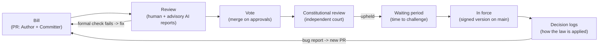

# Git-State

**Upgrading the infrastructure democracy runs on, not replacing it with a new kind of state.**

The idea: keep laws in a public git-style repository. Every change to a law is a pull request with a known author, every version has a legally significant signature, and decisions made under a law go into verifiable logs. The goal is to make the state's decisions **checkable**: you can see who changed what, when and why.

**What git can and can't do.** A repository can store versions, discussions, signatures and history. It can't make a court independent, enforce a ruling or guarantee a peaceful transfer of power. Those depend on who holds which powers, how officials are appointed, how decisions can be appealed and what happens when someone ignores `main`. This concept uses git as infrastructure, and it describes the legal guarantees separately, without relying on the analogy.

**Core principle: openness by default, privacy for citizens.** The state's actions are public unless a narrow, lawful exception applies, and every exception is itself recorded and reviewed. A person's private data stays closed, and the person can see which officials accessed it. If the direction of transparency is reversed, the same tooling becomes a surveillance system.

## Why now

Transparency has often failed because nobody could read it all. No citizen or newsroom can get through thousands of pages of laws and registries a day. AI makes reading cheap: it can summarize changes in plain language, compare versions and point out what deserves a human's attention. In this design AI is an assistant to human review, never an authority.

The goal is realistic. Corruption won't disappear, but it becomes more expensive and easier to see. Greed is a given, so the system is designed so that self-interested actors check each other.

## Structure

There are two feedback loops. Before the vote, review sends defects back to the author. After the law takes effect, application logs send real-world bugs back to the people who wrote it.

| Git | State |
| --- | --- |
| Pull request | Bill |
| Author / Committer | Who actually drafted the text / the legislator who introduced it |
| Code review | Committee readings, with advisory AI reports |
| Required status checks | Formal checks + constitutional review by an independent court |
| Approvals -> merge | Majority vote -> signature |
| Maintainer rejection | Veto |
| Timelock | Waiting period before a law takes effect (*vacatio legis*) |
| `git blame` | Who introduced a specific amendment |
| `git revert` | Repeal |
| Fork | Federalism: regions try different rules |
| Branch protection | The constitution and the threshold to amend it |
| Production logs | Logs of how the law is applied |

The analogy is a design aid, not a source of legitimacy. A merge is legitimate because of who votes and under what rules, not because git recorded it.

## Mechanisms

### 1. Atomic laws
One bill, one subject. This is already the *single-subject rule* in the constitutions of [43 US states](https://statecourtreport.org/our-work/analysis-opinion/single-subject-rules-can-prevent-perverse-outcomes-give-judges-enormous). It rules out omnibus bills that hide unrelated provisions. The same source notes a real cost: the rule gives judges significant power to decide what counts as "one subject".

### 2. Author vs. Committer
Git keeps these as separate fields, and so should laws.
- **Committer**: the legislator who introduced the bill.
- **Author / Co-authored-by**: who drafted the text, whether a ministry, a lobbyist or a law firm.
- Disclosure of drafting sources is mandatory (a *legislative footprint*), and knowingly false disclosure is an offense.

Text-similarity tools can show that a bill closely matches outside model language. [USA TODAY, the Arizona Republic and the Center for Public Integrity](https://publicintegrity.org/state-politics/copy-paste-legislate/how-we-uncovered-10000-times-lawmakers-introduced-copycat-model-bills-and-why-it-matters/) found at least 10,000 such bills across US states from 2010 to 2018. **A similarity flag is a signal, not an accusation.** It prompts a public question to the author. Any finding of undisclosed authorship comes from a human process with a right of reply and an appeal.

### 3. Review: human decisions, advisory AI
AI reports are **public and advisory**. They never block a vote on their own.
- **What AI reports cover:** a plain-language summary; the real diff against current law after resolving every cross-reference; provisions that seem unrelated to the bill's subject; conditions that appear to fit a single company; similarity to known model bills; possible conflicts with other laws. Bill text is treated as data, never as instructions (a defense against prompt injection).
- **What can block:** only formal checks with objective criteria, such as a missing mandatory section (subject statement, budget estimate, drafting sources) or an unresolved cross-reference. A formal block names the rule it is based on, and a human official confirms it.
- **Substantive comments:** a human body (for example, the parliamentary clerk's office) triages them. The author must publish an answer to the comments selected as material before the vote, but answering doesn't mean agreeing. Triage decisions are reasoned, public and open to appeal.
- **Abuse protection:** several independent reviewers can run (government, opposition, press). A comment counts only if a human adopts it, so a flood of automated comments can't stall a bill.

The point is that no legislator can say "I didn't know what was in it", while a model gets no veto.

### 4. Constitutional review by an independent court
Git can publish rulings and keep their history. It can't make a court independent. Independence comes from rules that are written into the constitution, not into the repository:
- appointment that no single branch or simple majority controls (for example, a supermajority, or several nominating bodies);
- a long, single, non-renewable term, so judges don't rule with reappointment in mind;
- removal only for cause, through a judicial procedure, never by a political vote alone;
- a budget protected from cuts used as retaliation;
- recusal rules and published reasoning for every decision.

A bill that has the votes still can't take effect if the court strikes it down. Changing how the court is appointed, how long judges serve or what the court may review counts as a constitutional change (see §5).

### 5. Waiting periods, emergencies and constitutional protection
- **Ordinary laws** take effect after a waiting period, so citizens, the press and courts can challenge them. *30 days is a starting hypothesis to be tested*, not a fixed number. The right period may depend on the type of law.
- **Urgent laws** need a fast track, or the emergency becomes the way around the process. The fast track is narrow:
  - it is available only on enumerated grounds, stated and justified publicly;
  - it has an automatic expiry (for example, 90 days), and renewal requires a supermajority;
  - every urgent law gets mandatory follow-up review by the court;
  - it may never change the constitution, the courts, elections or term limits.
- **The constitution** (the branch protection rules) can be changed only with the highest threshold and the longest waiting period, for example approval by two consecutive legislatures. Whoever can change these rules effectively holds admin rights, so they are the main target for attack.

## Decision logs

A law's real runtime is how it is applied, so the logs cover decisions made under the law, not just its text.

### Openness by default, narrow exceptions

| Layer | What is recorded | Who can see it |
| --- | --- | --- |
| Law and configuration | Every change as a diff, signed by a named official, with a public rationale and an effective date | Everyone |
| Decisions about individuals | The decision, the legal basis, the responsible official and who accessed the data | The person concerned sees their own records; the public sees aggregate statistics; courts and auditors have access under law |
| Restricted material (security, ongoing investigations, sensitive criteria) | The fact that an exception exists, its legal basis, who approved it and when it will be reviewed | The fact of the exception is public; the content goes to designated oversight bodies |

Every exception needs a named legal basis, an approving authority, independent review and periodic public reporting. When an exception expires, its content is **reviewed for release**. It is released unless a fresh, reasoned assessment shows that disclosure would harm people or an investigation, and that assessment is itself recorded. An exception that keeps getting renewed should be visible as exactly that.

### Integrity and completeness: a threat model

Hash chains and public anchoring prove only that **already recorded** entries haven't been changed afterwards. They can't detect a missing event, a false entry or a substitution made before recording. Each threat needs its own control:

| Threat | Control |
| --- | --- |
| An entry is changed after recording | Append-only log; hashes anchored publicly and mirrored by independent parties |
| An event is never recorded | **An unrecorded decision has no legal effect.** Recording is a condition of validity, so leaving a decision out of the log works against the official who made it. Per-register sequence numbers make gaps visible |
| A false or wrong entry | Every entry is signed by a named official; independent monitors and auditors reconcile logs with other registers and with what affected people received |
| An entry is substituted before recording | The affected party gets a signed receipt that must match the public log, the same idea as Certificate Transparency's signed timestamps |
| Errors | Corrections are added as new linked entries; history is never rewritten |

**Personal data never goes into a publicly replicated immutable log.** Only commitments (hashes) and non-personal metadata are public. The data itself stays in registers that have retention periods, so lawful deletion remains possible.

### Feedback and accountability
- **Bug reports go to authors.** If the logs show that some wording produces inconsistent decisions, that becomes a public bug report against the law. Vagueness left in as a political compromise then shows up as a cost. Open standards such as "reasonable care" or "good faith" that are genuinely needed stay in.
- **A named human is accountable.** Every automated system has a named responsible official. People have a right to an explanation and to a human review. The system is presumed fallible: software output is never treated as proof by default.

## Risks and defenses

| Risk | What it looks like | Defense |
| --- | --- | --- |
| Capture of the rules | A supermajority rewrites the constitution and reshapes the court | Highest threshold, longest waiting period, approval by two consecutive legislatures |
| Emergency as a bypass | Ordinary laws pushed through the fast track | Enumerated grounds, automatic expiry, mandatory court review, no constitutional changes |
| Reviewer capture or error | A tweaked or mistaken AI misses something or invents something | AI is advisory only; several independent reviewers; human triage with appeal |
| False authorship accusations | A similarity flag treated as proof | A flag only prompts a question; findings require a human process and an appeal |
| Over-broad secrecy | "Temporarily restricted", and the money moves there | Exceptions recorded, independently reviewed, reported and reviewed for release |
| Incomplete logs | Decisions made off the record | Unrecorded decisions have no legal effect; sequence numbers; reconciliation; receipts |
| Off-log deals | Agreed in private, recorded as a "technical" change | Public rationale, legislative footprint, the waiting period to challenge |
| Surveillance | Logs written about citizens instead of about power | Privacy by design: no personal data in public logs, access logging, retention limits |
| Exclusion | Only technical people can read diffs | Plain-language summaries; non-digital access channels |
| Force outside the system | Whoever controls the army ignores `main` | Code can't solve this. The record makes the violation visible, and the response is political and legal |

Infrastructure doesn't replace independent courts or a free press. Without them, even perfect logs are just an archive.

## Precedents

Each piece of the model already exists somewhere, or has already failed somewhere. No country has combined them.

| Precedent | What happened | Lesson for the model |
| --- | --- | --- |
| [DC Code on GitHub (2018)](https://www.route-fifty.com/management/2018/12/dc-code-meets-open-government-on-github/303406) | Joshua Tauberer submitted a pull request fixing a wrong cross-reference in the DC Code. A Council lawyer merged it, and the official code updated. It was a technical correction, not a substantive change | Keeping laws in git works today, at least for publication and corrections ([DCist](https://dcist.com/story/18/11/28/github-is-a-programming-website-so-what-is-d-c-s-legal-code-doing-on-there)) |
| [Bundes-Git (2012)](https://netzpolitik.org/2012/open-government-deutsche-bundesgesetze-und-verordnungen-jetzt-auch-als-git-repository/) | An activist project put German federal laws into git as Markdown, so the history shows how each law changed | Readable change history is cheap. The project wasn't part of the formal legislative process |
| [Archéo Lex](https://www.data.gouv.fr/reuses/archeo-lex-histoire-de-la-loi-francaise), [La loi sous git](https://www.data.gouv.fr/datasets/la-loi-sous-git/informations) | French legal codes with their version history, available as git repositories | The same idea for consolidated codes, updated from official data |
| [vTaiwan and ride-hailing (2015-2016)](https://www.technologyreview.com/s/611816/the-simple-but-ingenious-system-taiwan-uses-to-crowdsource-its-laws/) | Public deliberation found consensus on Uber regulation, and the government adopted rules along those lines. The outcome was not binding | Public review works best when the government is obliged to respond |
| Iceland's constitutional draft ([referendum results, 2012](https://www.stjornarradid.is/frettir/grein/2012-10-31-Advertisement-of-the-results-of-the-referendum-on-20-October-2012); [Venice Commission newsletter, 2013](https://www.venice.coe.int/Newsletter/NEWSLETTER_2013_02/2_ICE_EN.html)) | A citizen council drafted a constitution in 2011. In a non-binding referendum, about two-thirds of valid votes backed it as the basis for a new constitution (turnout about 49%). The bill stalled in parliament and was not adopted before the 2013 elections | A complex parliamentary path, not a simple rejected PR. Without defined steps and deadlines for the maintainers, a proposal can stall indefinitely |
| [Estonia's Data Tracker](https://ria.ee/en/state-information-system/people-centred-data-exchange/data-tracker) | Citizens see on eesti.ee how their personal data was used in public-sector registers that implement the protocol | Access logs that citizens can see already work, but only for connected systems |
| [Certificate Transparency and Symantec (2017-2018)](https://groups.google.com/a/chromium.org/g/blink-dev/c/eUAKwjihhBs/m/El1mH8S6AwAJ?pli=1) | Investigations into Symantec's certificate validation failures led Chrome to distrust its certificates step by step | Public append-only logs plus independent monitors work at internet scale |
| [The DAO (2016)](https://labs.withsecure.com/publications/the-hack-that-changed-the-blockchain-perspective) | A contract bug drained about 3.6M ETH. The community reversed it with a hard fork | "Code is law" gave way in a crisis; humans still decide |
| [Beanstalk (2022)](https://bean.money/blog/beanstalk-governance-exploit) | A flash loan bought a governance supermajority. It passed a proposal through an emergency path with a 24-hour delay and drained the protocol (about $182M moved, about $76M net to the attacker) | A delay alone isn't enough. It has to be long enough for humans to react, voting power has to be fixed before a proposal and emergency paths are the weakest point |
| [UK Post Office Horizon](https://www.irishnews.com/news/uk/the-post-office-scandal-what-is-it-and-has-anyone-been-held-accountable-VSJTQHLEC5NQXNVMYL2C5IDRNU/) | About 736 subpostmasters were convicted between 2000 and 2015 on evidence from faulty accounting software | Software output must never be presumed correct |
| [Dutch childcare benefits scandal](https://en.wikipedia.org/wiki/Dutch_childcare_benefits_scandal) | Tens of thousands of families were wrongly treated as fraudsters, and the tax authority admitted singling out dual nationals. The cabinet resigned in January 2021 | Aggregate statistics on decisions could reveal discriminatory patterns early |
| [Robodebt (Australia)](https://www.indailysa.com.au/news/archive/2023/07/07/robodebt-public-servants-face-prosecution-after-royal-commission-report) | A Royal Commission found the automated debt scheme unlawful and recommended referrals and a body to oversee automated decision-making | Automated decisions need a named accountable official and external oversight |
| [Hungary's constitutional changes (2011-2013)](https://www.venice.coe.int/Newsletter/NEWSLETTER_2013_03/1_HUN_EN.html) | The Venice Commission criticized limits on the Constitutional Court's review powers and the broad use of two-thirds "cardinal laws" | Whoever can change the protection rules can neutralize the checks |

## Scope and open questions

These are not solved yet, and each needs an answer before a real pilot:

- **Which version is legally binding.** The signed text on `main`, an official gazette or both, and what happens if they differ.
- **Identity.** How authors, committers and signing officials are authenticated (for example, qualified electronic signatures) and how a compromised key is revoked.
- **Restricted annexes.** How classified parts of a law are referenced and reviewed without being published.
- **Accessibility.** Plain-language versions, offline access and help for people without digital skills.
- **Retention.** How long logs and underlying data are kept, and who may delete what and when.
- **Who runs the infrastructure.** Hosting, mirroring and keys must not depend on one agency or one vendor.
- **Cost and capacity.** Who staffs triage, oversight and complaint handling.

## Adoption path

Each step has a measurable result before the next one starts.

1. **Authoritative versions.** Each law has a legally significant signed text, a full version history and a readable comparison between versions. *Result: anyone can get the binding text of a law on any date and see what changed.*
2. **Completeness checks and complaints.** Independent reconciliation of what is published against what was enacted and decided, plus a simple public complaint process. *Result: published audits of completeness with tracked fixes.*
3. **Authorship disclosure and atomic bills.** Legislative footprint and the single-subject rule. *Result: drafting sources disclosed for every bill.*
4. **Advisory AI reports.** Public, non-binding reports for every bill, with human triage. *Result: measured accuracy, plus a record of which comments mattered.*
5. **Decision logs.** For automated and high-impact decisions first, with a named official, a right to explanation and human review. *Result: people can see and contest decisions about themselves.*
6. **Waiting periods, the emergency track and constitutional protection.** This needs constitutional reform. *Result: urgent laws expire automatically unless reviewed.*

Small, high-trust digital states (Estonia, Iceland, Taiwan) and cities or regions, acting as "forks" at the level of local rules, are the most likely early adopters.

## Bottom line

The system of government stays the same; what changes is the infrastructure it runs on. Versioned laws, transparent authorship, advisory AI review, verifiable logs and an independent court won't remove corruption. They make it more expensive and easier to see, and they take away the "I didn't know" excuse. Git provides the record. Independence, enforcement and legitimacy still come from the rules and from the people who defend them.

---

*A concept, not a finished proposal. Issues and pull requests are welcome, which seems fitting.*

---

*"When the government violates the rights of the people, insurrection is for the people and for each portion of the people the most sacred of rights and the most indispensable of duties."*

Declaration of the Rights of Man and of the Citizen (1793), Article 35. The same words are on the Black Cone, Santiago Sierra's Monument to Civil Disobedience in front of Iceland's parliament in Reykjavík.
