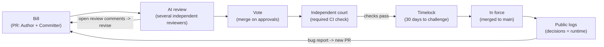

# Git-State

**Upgrading the infrastructure democracy runs on, not replacing it with a new kind of state.**

The idea: run the state like a public git repository. Laws are code, every change to a law is a pull request, and every decision the state makes goes into an append-only public log. Accountability, peaceful transfer of power and independent courts stay the foundation. Git and AI make them cheap, fast and hard to bypass.

**Core principle: the state is transparent, the citizen is private.** Everything the government does is public. Everything about a person's private life is closed, and the person can see who accessed their data. Flip the direction of transparency and the same stack becomes a digital dictatorship.

## Why now

Transparency used to fail because nobody could read it. No citizen or newsroom can get through thousands of pages of laws, registries and procurement records a day. AI makes that reading layer cheap: it can review bills, flag anomalies and explain any change in plain language.

Every information revolution has reshaped the state. The printing press brought published law, and the industrial era brought professional bureaucracies hired by exam instead of patronage. AI can bring a state that machines can read and citizens can verify in real time.

The goal is realistic. Corruption won't disappear, but it becomes expensive and visible. Greed is a given, so the system is designed to make each self-interested actor check the others.

## Structure

Two feedback loops keep the system honest. Before the vote, open review comments send a bill back to its author. After the law is in force, enforcement logs send bugs back to the people who wrote it.

| Git | State |
| --- | --- |
| Pull request | Bill |
| Author / Committer | Who actually wrote the text / the legislator who introduced it |
| Code review | Committee readings + AI review |
| Required status checks (CI) | Independent constitutional court |
| Approvals -> merge | Majority vote -> signature |
| Maintainer rejection | Veto |
| Timelock | Delay before a law takes effect (*vacatio legis*) |
| `git blame` | Who introduced a specific amendment |
| `git revert` | Repeal |
| Fork | Federalism: regions try different rules |
| Branch protection + admin bypass | The constitution and the threshold to amend it |
| Production logs | Public logs of how the law is enforced |

## Mechanisms

### 1. Atomic laws
One bill, one subject (the *single-subject rule*, already in many US state constitutions). This rules out thousand-page omnibus bills that hide unrelated amendments.

### 2. Author vs. Committer
Git keeps these as separate fields, and laws should too.
- **Committer**: the legislator who introduced the bill.
- **Author / Co-authored-by**: who actually wrote the text, whether a ministry, a lobbyist or a law firm.
- The Author field is mandatory (a *legislative footprint*). False authorship is an offense. An AI reviewer catches undisclosed co-authors by comparing the text with known lobby templates.

### 3. AI review with blocking comments
The AI reviews bills but never approves them. It flags:
- riders, meaning provisions unrelated to the bill's subject;
- the real diff against current law, after resolving every cross-reference;
- conditions that fit exactly one company (checked against public registries);
- text copied from lobby templates, conflicts with other laws, and a rough budget impact;
- hidden instructions aimed at AI reviewers (prompt injection). Bill text is data, never instructions.

The rules work like GitHub's. Review reports are published before the vote. The author must answer every serious comment in public. **Unresolved comments block the vote.** Several independent reviewers run in parallel (government, opposition, press), and review time grows with the size of the bill. The main effect is that no legislator can claim they didn't know what was in the bill.

### 4. CI = an independent constitutional court
A bill merges once it has enough approvals (a majority vote), but only if the required CI check passes. The court must be independent of the maintainers. A simple majority can neither bypass it nor reconfigure it.

### 5. Timelocks and branch protection
- An ordinary law takes effect after a timelock, for example 30 days, so citizens, the press and courts have time to challenge it.
- Changing the protection rules themselves (the constitution, the court's powers) requires the highest threshold and the longest timelock. These are the admin rights, and capturing them is the system's main attack vector.

## Runtime: decision logs

A law's real runtime is enforcement, so every decision made under a law is logged, not just its text. Who can see a log depends on whose data is in it.

| Layer | What is logged | Who can see it |
| --- | --- | --- |
| Code and configuration | Every change as a diff, signed by a named official, with a public rationale and an effective date after the timelock | Everyone |
| Decisions about people | The decision, the reason, and who accessed the data | The citizen sees everything about themselves; the public sees anonymized statistics; auditors and courts see everything |
| Sensitive criteria (e.g. how tax audits are selected) | Rules and thresholds | Auditors immediately; everyone else after a delay |

- **Tamper-evident.** Logs are append-only. Their hashes are regularly anchored to a public blockchain and mirrored to independent parties (courts, opposition, press, foreign mirrors), so nobody can quietly rewrite history.
- **No exemptions.** Within a month, any area exempted from logging "temporarily" or "for security reasons" becomes the channel the money flows through. If an exemption is unavoidable, the exemption itself is logged publicly, has an expiry date and is fully disclosed when it ends.
- **Bug reports go to authors.** If the logs show that some wording produces contradictory court rulings, that goes back to the law's authors as a bug report. Vagueness written in as a political compromise becomes a liability for whoever voted for it. Standards that are genuinely needed ("reasonable care", "good faith") stay.
- **A named human is accountable.** Every automated system has a named responsible official. Citizens have a right to an explanation and to appeal to a human. The system is presumed fallible: software is never right by default.

## Risks and defenses

| Risk | What it looks like | Defense |
| --- | --- | --- |
| Admin-rights capture | A supermajority rewrites the constitution and reshapes the court | Highest threshold + longest timelock, possibly approval by two consecutive legislatures |
| Reviewer capture | A tweaked AI conveniently stops seeing certain things | Several independent reviewers with public reports; disagreement between them is itself a signal |
| Logging exemptions | "Temporarily classified", and the money moves there | Exemptions are logged, have an expiry date and are fully disclosed afterwards |
| Off-log deals | Agreed over dinner, logged as a "technically justified" change | Public rationale, legislative footprint, right to challenge during the timelock |
| Writing around the AI | Wording the reviewer fails to recognize | A permanent arms race, but deception gets much more expensive; human review by the press remains |
| Prompt injection | Hidden text in a bill aimed at AI reviewers | Bill text treated as data; a dedicated scan for hidden content |
| Surveillance | Logs written about citizens instead of about power | "Transparent state, private citizen" written into the constitution |
| Digital divide | Only technical people can read diffs | An AI plain-language summary of every change |
| Force outside the repo | Whoever controls the army ignores `main` | Code can't solve this, but the log makes the violation visible to everyone, which is itself a deterrent |

Infrastructure doesn't replace independent courts or a free press. Without them, even perfect logs are just an archive.

## Real-world precedents

Each piece of the model already works somewhere, or has already failed somewhere, but no country has put the whole thing together. *Facts and dates below are from memory and approximate; verify before citing.*

| Precedent | What it shows | Lesson for the model |
| --- | --- | --- |
| DC Code on GitHub (2016) | A citizen fixed a typo in the official legal code through a pull request | Laws in git already work technically |
| Bundesgit, Archéo Lex | German federal law and French codes in git with line-by-line history | Legislative history becomes readable |
| vTaiwan | Citizens deliberate on bills; the government responds to the consensus | Public "review" by citizens |
| Iceland's crowdsourced constitution (2011–2012) | Approved in an advisory referendum; parliament never merged it | Without a duty for maintainers to respond, a PR quietly dies |
| Estonia's Data Tracker | Citizens see which official looked at their data; snooping leads to dismissal and prosecution | "Transparent state, private citizen" in practice |
| Certificate Transparency | Every HTTPS certificate goes into a public append-only log; it caught Symantec misissuing | Tamper-evident logs work at global scale |
| Open public procurement (ProZorro and similar) | Scandals surface from open data, while the big schemes move to closed zones | Any logging exemption becomes a hole |
| The DAO (2016), Beanstalk (2022) | A code bug led to a hard fork; a flash loan bought a governance majority and drained the treasury in seconds | "Code is law" breaks in a crisis; timelocks are essential |
| UK Post Office Horizon scandal | Faulty software led to 900+ wrongful convictions | Presume the system can be wrong |
| Dutch childcare benefits scandal, Australia's Robodebt | Algorithms falsely accused thousands; accountability came years later | Anonymized decision statistics would have exposed the bias early |
| Hungary after 2010 | A supermajority rewrote the constitution and the court | Admin rights are the primary attack target |

## Adoption path

Nobody will adopt the whole system voluntarily, because it strips power of its usual opacity. The realistic path is incremental, from cheap to hard:

1. **Laws in git.** An official legal code with line-by-line history and Author/Committer fields. Technically cheap and politically neutral.
2. **Mandatory AI review.** Reports published before every vote. Advisory at first, then with blocking comments.
3. **Atomic laws + legislative footprint.** The single-subject rule and mandatory disclosure of authorship.
4. **Data-access logs and open procurement with no exemptions.** On the Estonian model, but with no permanent "classified" zones.
5. **Enforcement and automated-decision logs.** With a named responsible official, a right to explanation and a right to appeal.
6. **Timelocks and constitutional branch protection.** The hardest step, since it needs constitutional reform.

Small, high-trust digital states are the most likely first movers: Estonia, Iceland, Taiwan. So are cities and regions, which can act as "forks" at the level of local rules.

## Bottom line

The system of government stays the same; what changes is the infrastructure it runs on. Laws as a repository, AI as a reviewer, an independent court as CI and public logs as runtime don't remove corruption. They make it expensive and visible, and they take away the "I didn't know" excuse. The one weak spot is admin rights, so changing the rules themselves has to be the slowest and most expensive action in the system.

---

*A concept, not a finished proposal. Issues and pull requests are welcome, which seems fitting.*

---

*"When the government violates the rights of the people, insurrection is for the people and for each portion of the people the most sacred of rights and the most indispensable of duties."*

Declaration of the Rights of Man and of the Citizen (1793), Article 35. The same words are on the Black Cone, Santiago Sierra's Monument to Civil Disobedience in front of Iceland's parliament in Reykjavík.
